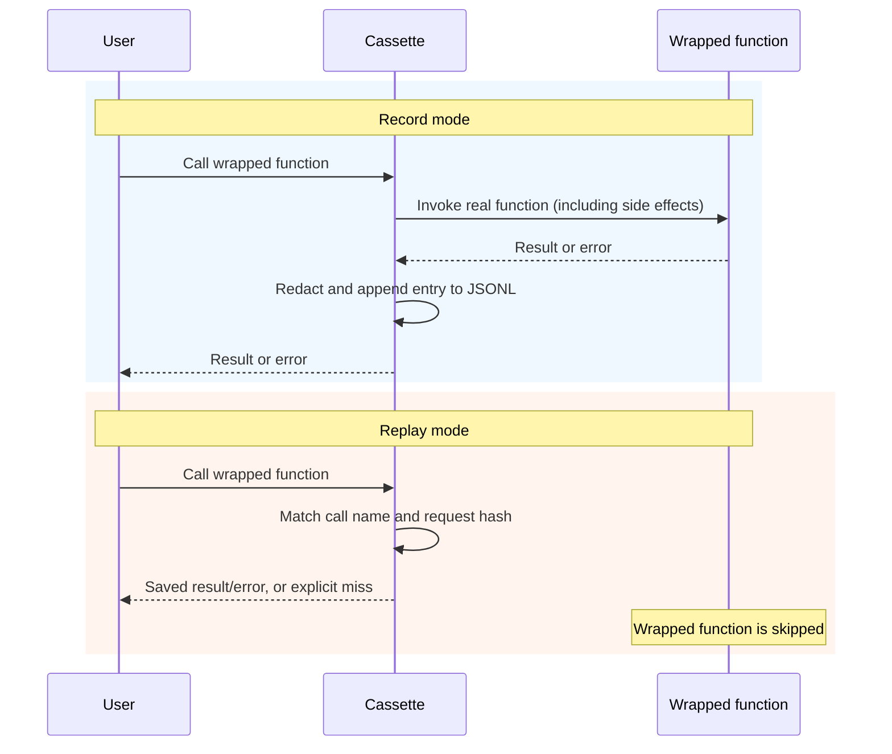

# Agent Cassette 📼

**Record calls → replay saved results → offline regression tests for AI agents.**

Agent Cassette is a lightweight record-and-replay harness for agent workflows.
It captures explicitly wrapped LLM and tool calls so you can test application behavior against saved results without repeating those external calls. Recordings can include usage and latency metadata from the original run.

> **v0:** Explicit wrapper–based TypeScript prototype.
>
> **v1:** (Planned) Network interceptor plugin.

---

## Why This Exists

Agent runs are often flaky and expensive:

- **Non-determinism:** The same prompt can produce different outputs.
- **Slow feedback:** Integration tests can spend substantial time waiting on network calls.
- **Cost:** Repeated debugging burns tokens and money.

Cassette turns "I swear it failed yesterday" into a versioned recording you can replay.

---

## Example: Node-RED Flow Generation

**(See [`examples/node-red-generator.ts`](./examples/node-red-generator.ts))**

The example records an OpenAI response and a simulated Node-RED deployment:

1. **Saved responses:** Replay supplies the recorded JSON output to the application's parsing and orchestration code.
2. **Illustrative validation:** The simulated deployment checks for `msg.payload` and `return msg` substrings and substitutes fallback code when either is missing. This does not validate JavaScript syntax, flow schemas, wiring, coordinates, or code safety. Replaying the deployment returns its saved result and skips that validation function.
3. **Regression scope:** Offline replay tests behavior with existing recordings. It does not evaluate a newer model's output or prove a model upgrade is compatible. Changing the model changes the request identity and requires separately evaluated recordings.

---

## Architecture



<details>
<summary>Text diagram (if Mermaid doesn't render)</summary>

```
Record: call → invoke real function → append result/error → return
Replay: call → lookup saved entry → return result/error, or throw a miss
Only wrapped functions are skipped during replay.
```

</details>

---

## How It Works (v0)

Cassette wraps async functions and records `{request_identity → result}` as JSONL (one JSON object per line). JSONL is append-friendly, but an incomplete or malformed line currently prevents the entire file from loading; there is no automatic crash recovery.

**Modes:**

| Mode          | Behavior                                                         |
| ------------- | ---------------------------------------------------------------- |
| `record`      | Call real function, append its result or error                   |
| `replay`      | Match call name/hash, return saved result/error, or throw a miss |
| `passthrough` | Call without recording                                           |
| `auto`        | Replay if cassette exists, otherwise record                      |

Replay skips the wrapped function only; it does not intercept other network calls or side effects. Use an explicit `replay` mode for offline workflows. Validate mode strings at runtime when accepting external configuration: TypeScript casts do not validate them, and an unrecognized mode currently falls through to recording.

### Identity and compatibility limits

The Responses helper includes the full `text.format` contract in both strict and lenient profiles, with object keys canonicalized recursively. Explicit formats therefore miss older recordings whose hashes omitted that field. Requests without a format retain their old hashes, which can still match an unmigrated recording originally made with a format. Audit or isolate legacy recordings before relying on them; see the [bounded migration of the trusted Node-RED fixtures](docs/engineering/node-red-cassette-migration-proposal.md).

The helper is a partial request projection. Tool schemas, non-message structured input fields (such as function-call outputs), `previous_response_id`, and `text.verbosity` are separate correctness follow-ups: differences in those fields can currently produce wrong replay hits in both profiles. For such requests, supply a `buildRequestIdentity` that preserves every field relevant to your application instead of relying on this helper. The pinned SDK does not yet declare `text.verbosity`.

Recordings can contain prompts, outputs, error stacks, and metadata. Default redaction covers only selected bearer-token and `sk-` patterns; review recordings before sharing them.

---

## Quickstart (Node-RED Demo)

The checked-in fixtures support offline replay immediately after installation. Recording is optional and makes paid API calls.

### 1. Install & Setup

```bash
npm ci
```

The examples read environment variables directly; they do not automatically load `.env` files. See `.env.example` for variable names.

### 2. Record (Optional)

Requires OpenAI API Key. Captures the run trace to disk.

```bash
export OPENAI_API_KEY="sk-..."
npm run nodered:record
```

### 3. Replay (The "Regression Test")

No API key is required for the supplied recordings.

```bash
unset OPENAI_API_KEY
npm run nodered:replay
```

Reported token estimates come from saved usage metadata. Replay incurs local work and makes no new wrapped provider calls; it does not measure live model quality or actual financial savings.

### 4. Docker (Offline Replay)

Use committed files as the build context to exclude untracked local files. Review tracked contents before sharing an image. This exercises the demo in a container, not a production deployment.

```bash
git archive HEAD | docker build -t agent-cassette -
docker run agent-cassette
```

---

## Development & Contribution

We use ESLint and Prettier to maintain high engineering standards.

CI and Docker currently target Node.js 20, which is [end-of-life](https://nodejs.org/en/about/previous-releases). Moving both to a supported LTS is a separate maintenance follow-up.

```bash
# Run Unit Tests
npm test

# Check Code Quality
npm run lint
./node_modules/.bin/tsc --noEmit

# Exercise both supplied offline workflows
npm run demo:replay
npm run nodered:replay
```

---

## Roadmap

### v0: Explicit Wrappers (Current)

- **Architecture:** Manual wrapping of specific functions.
- **Status:** Prototype with TypeScript checks and offline replay tests; identity limitations are listed above.
- **Trade-off:** High control, but requires code changes to integrate.

### v1: Network Interception (Planned)

- **Goal:** "Drop-in" recording without changing application code.
- **Strategy:** Implement the Proxy Pattern using `undici` dispatchers or `msw` to intercept HTTP traffic at the network layer.
- **Benefit:** Zero-touch integration for existing codebases.

### v2: Observability Dashboard (Planned)

- **Goal:** Visualize the "Drift."
- **Strategy:** A Web UI to diff "Record" vs "Replay" traces.
- **Benefit:** Deeply understand failures (e.g., "Prompt changed on line 4").
